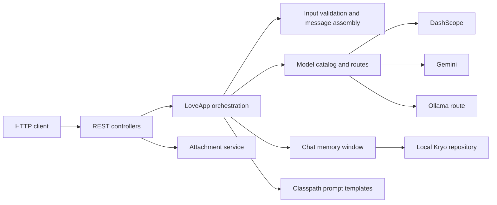

# HC AI Knowledge Assistant

A Java 21 and Spring AI backend for multimodal conversations. The current application demonstrates a **relationship advice assistant**: users can chat with text or an image, switch between supported models, continue a conversation, and request a structured report.

This is a portfolio project and a single-user backend. It does **not** currently implement document retrieval, a vector database, user authentication, or a frontend.

## Highlights

- **Multimodal chat:** text, one JPEG/PNG/WebP image, or an image-only prompt. A later message can refer to an image already in the conversation.
- **Model routing:** choose a model for each request. The catalog reports each model's supported input types. DashScope is the default route; Gemini Pro and Flash-Lite can be enabled with an API key.
- **Conversation memory:** a bounded Spring AI message window backed by local Kryo files. A conversation-level lock protects the read, model call, and successful write sequence within one application instance.
- **Structured reports:** a prompt template and output schema produce a report with a title and suggestions.
- **Request validation:** image content is checked by format, size, and pixel count; unsupported model/input combinations return explicit errors. A custom Advisor checks user text against a small example blocklist.
- **Testable provider integration:** automated tests cover HTTP endpoints, model selection, attachment handling, memory behavior, and Gemini requests against a local stub without consuming API quota.

## Architecture



The request path is: validate input → resolve the model → lock the conversation → load recent messages and referenced images → build a multimodal Spring AI request → call the provider → parse the result → save the user and assistant messages together. A failed model call or invalid report leaves the conversation memory unchanged.

| Module | Responsibility |
| --- | --- |
| `controller` | REST endpoints and consistent error responses |
| `app` | Chat and report use cases, request validation, message assembly, and prompt templates |
| `model` / `config` | Model catalog, input capabilities, provider clients, and application configuration |
| `attachment` | Upload validation, metadata, and local image storage |
| `memory` | Conversation coordination and bounded, file-backed chat memory |
| `advisor` | Reusable request interception examples |

## Technology choices

| Technology | Role |
| --- | --- |
| Java 21, Spring Boot 3.4.4 | Application runtime and REST API |
| Spring AI 1.1.2 | `ChatClient`, messages, model abstraction, and chat memory |
| Spring AI Alibaba / DashScope | Default text model integration |
| Google GenAI SDK through Spring AI | Optional Gemini image and text model integration |
| Ollama | Optional local model route |
| Kryo 5.6.2 | Serialization for the local chat-memory repository |
| Maven, JUnit 5, Spring Boot Test | Build and automated verification |
| springdoc / Knife4j | OpenAPI documentation |

The repository also retains small LangChain4j and direct SDK examples for comparison. An experimental MySQL `ChatMemoryRepository` and table schema are present, but the running application still uses local files; MySQL is **not** configured or verified here.

## Run locally

1. Install Java 21. The Maven Wrapper is included.
2. Copy `src/main/resources/application-local.yml.example` to `src/main/resources/application-local.yml`, which is ignored by Git.
3. Set `AI_DASHSCOPE_API_KEY` for the default DashScope route. To use Gemini, set `GEMINI_API_KEY`, enable `app.gemini.enabled`, and choose `app.love.model: gemini-2.5-pro` or `gemini-2.5-flash-lite` in the local file. Use a model available to your account.
4. Start the service:

```sh
./mvnw spring-boot:run
```

The API base URL is `http://localhost:8123/api`. OpenAPI UI is available at `/api/swagger-ui.html`.

## API at a glance

| Endpoint | Purpose |
| --- | --- |
| `GET /api/ai/models` | List available routes and supported input types |
| `POST /api/attachments` | Upload an image and receive a `fileId` |
| `POST /api/love/chat` | Send text and/or an image reference |
| `POST /api/love/report` | Generate a structured advice report |

```sh
curl http://localhost:8123/api/ai/models

curl http://localhost:8123/api/love/chat \
  -H 'Content-Type: application/json' \
  -d '{"chatId":"demo-1","model":"dashscope","text":"How can I communicate more clearly?","attachments":[]}'
```

For an image, upload it to `/api/attachments`, then include the returned `fileId` in `attachments`. See [API guide](docs/api.md).

## Verification

```sh
./mvnw clean test
```

The default suite uses mock providers or a local HTTP stub. Live provider tests are opt-in with `RUN_LIVE_AI_TESTS=true` and require valid credentials.

## Scope and next steps

The current local storage and locking model is designed for one application instance. The application has no user accounts, tenant isolation, attachment expiry, or disk-wide quota. Before exposing it to multiple users, add authenticated ownership for conversations and files, shared storage, and cross-instance coordination. A complete chat history should be stored separately from the bounded context window.

The name describes the direction of the project; a searchable knowledge base and retrieval-augmented generation are future work.

## Documentation

- [API and behavior](docs/api.md)
- [Configuration and model routing](docs/configuration.md)
- [Architecture and design decisions](docs/architecture.md)
