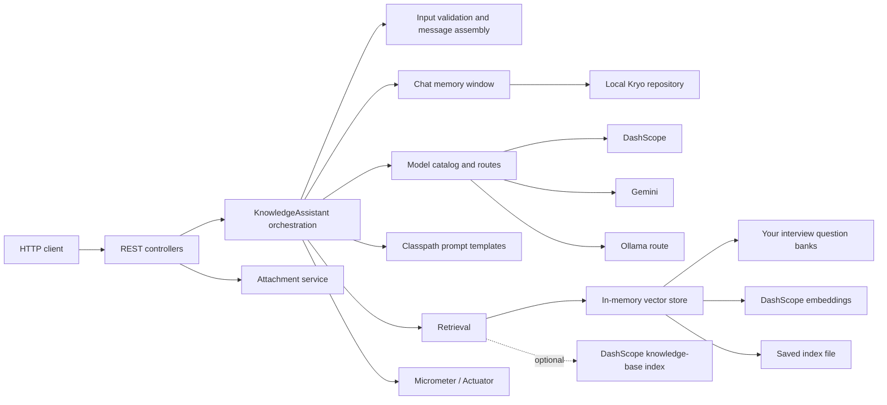

# HC AI Knowledge Assistant

A Java 21 and Spring AI backend for multimodal conversations. The application is an **interview preparation assistant**: users can chat with text or an image, switch between supported models, continue a conversation, request a structured study report, and ask questions answered from a knowledge base of interview questions (retrieval-augmented generation, RAG).

> **The question banks are not included in this repository.** Put your own Markdown question banks in `src/main/resources/document/` before running RAG or its tests. See [Knowledge base](#knowledge-base) for the required format.

This is a portfolio project and a single-user backend. It does **not** implement user authentication, multi-tenant isolation, a persistent vector database, or a frontend.

## Highlights

- **Multimodal chat:** text, one JPEG/PNG/WebP image, or an image-only prompt. A later message can refer to an image already in the conversation.
- **Model routing:** choose a model for each request. The catalog reports each model's supported input types. DashScope is the default route; Gemini Pro and Flash-Lite can be enabled with an API key.
- **Conversation memory:** a bounded Spring AI message window backed by local Kryo files. A conversation-level lock protects the read, model call, and successful write sequence within one application instance.
- **Structured study reports:** a prompt template and output schema produce a report with a title (the main gap to work on) and prioritised revision suggestions.
- **Knowledge-base retrieval (RAG):** `POST /api/assistant/rag` retrieves the most similar interview questions (configurable top-k and similarity threshold), answers from them with question IDs such as `[Q03-017]`, and returns them as `sources` (ID, bank, category, title, score, excerpt). Only the original question and the answer are saved to memory. The embedded index is saved to disk and reused until the documents or embedding model change. An optional cloud path (`POST /api/assistant/rag/cloud`, DashScope knowledge-base index through Spring AI's `RetrievalAugmentationAdvisor`) is switched on with one property.
- **Retrieval evaluation:** a labelled set of 46 questions (40 answerable, 6 out of scope) measures hit rate, mean reciprocal rank, and score separation, and suggests a similarity threshold.
- **Metrics:** Actuator exposes `hc.ai.*` meters for model-call latency and outcome, token usage, retrieval time, passages per question, and no-match questions, without recording message text.
- **Request validation:** image content is checked by format, size, and pixel count; unsupported model/input combinations return explicit errors. A custom Advisor checks user text against a small example blocklist.
- **Testable provider integration:** automated tests cover HTTP endpoints, model selection, attachment handling, memory behavior, and Gemini requests against a local stub without consuming API quota.

## Architecture



The chat path is: validate input → resolve the model → lock the conversation → load recent messages and referenced images → build a multimodal Spring AI request → call the provider → parse the result → save the user and assistant messages together. A failed model call or invalid report leaves the conversation memory unchanged.

The RAG path checks the question against the blocklist, retrieves passages above the similarity threshold, and wraps them with the question in a grounded prompt that tells the model to treat the material as information rather than instructions. When nothing matches, the model is told so and can still use the conversation history. Retrieved text is used for that call only and returned as `sources`.

| Module | Responsibility |
| --- | --- |
| `controller` | REST endpoints and consistent error responses |
| `app` | Chat and report use cases, request validation, message assembly, and prompt templates |
| `model` / `config` | Model catalog, input capabilities, provider clients, and application configuration |
| `attachment` | Upload validation, metadata, and local image storage |
| `memory` | Conversation coordination and bounded, file-backed chat memory |
| `advisor` | Metrics, blocklist check, and optional request logging |
| `rag` | Document loading, saved vector index, cloud retrieval, settings, and retrieval evaluation |

## Technology choices

| Technology | Role |
| --- | --- |
| Java 21, Spring Boot 3.4.4 | Application runtime and REST API |
| Spring AI 1.1.2 | `ChatClient`, messages, model abstraction, chat memory, `SimpleVectorStore`, Markdown reader, and `RetrievalAugmentationAdvisor` |
| Spring AI Alibaba 1.1.2.2 / DashScope | Default text model, embedding model, and cloud document retriever |
| Google GenAI SDK through Spring AI | Optional Gemini image and text model integration |
| Ollama | Optional local model route |
| Kryo 5.6.2 | Serialization for the local chat-memory repository |
| Maven, JUnit 5, Spring Boot Test | Build and automated verification |
| springdoc / Knife4j | OpenAPI documentation |
| Spring Boot Actuator, Micrometer | Health endpoint and application metrics |

The repository also retains small LangChain4j and direct SDK examples for comparison. An experimental MySQL `ChatMemoryRepository` and table schema are present, but the running application still uses local files; MySQL is **not** configured or verified here.

## Run locally

1. Install Java 21. The Maven Wrapper is included.
2. Copy `src/main/resources/application-local.yml.example` to `src/main/resources/application-local.yml`, which is ignored by Git.
3. Set `AI_DASHSCOPE_API_KEY` for the default DashScope route. To use Gemini, set `GEMINI_API_KEY`, enable `app.gemini.enabled`, and choose `app.assistant.model: gemini-2.5-pro` or `gemini-2.5-flash-lite` in the local file. Use a model available to your account. RAG always needs the DashScope key, because document and query embeddings use the DashScope embedding model even when chat uses Gemini.
4. Start the service:

```sh
./mvnw spring-boot:run
```

The API base URL is `http://localhost:8123/api`. OpenAPI UI is available at `/api/swagger-ui.html`.

## API at a glance

| Endpoint | Purpose |
| --- | --- |
| `GET /api/ai/models` | List available routes and supported input types |
| `POST /api/attachments` | Upload an image and receive a `fileId` |
| `POST /api/assistant/chat` | Send text and/or an image reference |
| `POST /api/assistant/report` | Generate a structured study report |
| `POST /api/assistant/rag` | Answer a text question from the bundled knowledge base, with sources |
| `POST /api/assistant/rag/cloud` | Same, using a DashScope cloud index (only when enabled) |
| `GET /api/actuator/health`, `/api/actuator/metrics` | Health and metrics |

```sh
curl http://localhost:8123/api/ai/models

curl http://localhost:8123/api/assistant/chat \
  -H 'Content-Type: application/json' \
  -d '{"chatId":"demo-1","model":"dashscope","text":"How can I communicate more clearly?","attachments":[]}'

curl http://localhost:8123/api/assistant/rag \
  -H 'Content-Type: application/json' \
  -d '{"chatId":"demo-2","message":"When does Spring @Transactional not take effect?"}'
```

For an image, upload it to `/api/attachments`, then include the returned `fileId` in `attachments`. See [API guide](docs/api.md).

## Verification

```sh
./mvnw clean test
```

The default suite uses mock providers or a local HTTP stub and does not need the question banks; the one test that reads your banks (`KnowledgeBaseLoaderTest.loadsEveryLocalQuestionWithAUniqueId`) is skipped when the folder is empty. Live provider tests are opt-in with `RUN_LIVE_AI_TESTS=true` and require valid credentials.

**The two live RAG tests are written against the author's question banks**, so with your own banks you need to adapt them: create `src/test/resources/rag-eval/eval-set.json` (ignored by Git; the evaluation is skipped without it) with questions and expected question IDs from your banks, and change the questions and expected answers in `KnowledgeAssistantRagLiveTest` (for example the `@Transactional` question that expects a `Q03-` citation).

The live RAG test (`KnowledgeAssistantRagLiveTest`) checks grounded advice, three-turn memory, isolation between conversations, and that the model admits when the knowledge base has no answer; it saves each exchange as a transcript for diagnosis.

To measure retrieval quality and choose a similarity threshold (embedding calls only, no chat calls):

```sh
RUN_LIVE_AI_TESTS=true ./mvnw test -Dtest=RagRetrievalEvaluationLiveTest
# report: target/rag-eval/report.md
```

## Knowledge base

The knowledge base is read from `src/main/resources/document/*.md`. **These files are ignored by Git and are not part of the repository:** the author's banks are personal revision material. To run RAG, add your own question banks to that folder. Without them the application still starts and ordinary chat works, but RAG answers have no reference material.

Every `*.md` file in the folder is loaded. Each file is one question bank and must follow this layout:

- `# <bank name>` once at the top, for example `# 03 Java Backend`.
- `## Qnn-nnn <question>` for every question: `nn` is the two-digit bank number and `nnn` the three-digit question number, for example `Q03-017`. IDs must be unique across all files.
- An optional `Category: <category> | Priority: <High|Medium|Low>` line straight after the heading.
- The answer, which may contain lists, tables and fenced code blocks. Headings inside code blocks are ignored.

Each question and its whole answer become one passage. Questions with an empty answer are skipped with a warning.

```markdown
# 03 Java Backend

## Q03-001 Which JDK tools have you used?

Category: Java Fundamentals | Priority: High

Answer text, lists, tables and code blocks...
```

For reference, the author's local knowledge base has 11 English banks with 1,233 questions (job search and project deep dives, AI application development, Java backend, Python and Node.js backend, frontend, databases and middleware, system design, cloud and DevOps, CS fundamentals, Australian interview essentials, and HR and behavioural interviews). The first RAG request embeds every question, which takes a few minutes for a bank of that size; the index is then saved to `tmp/rag-index/` and reused until a bank or the embedding model changes.

`POST /api/assistant/rag` indexes these files, one passage per question, and returns the questions it used in `sources`. The labelled evaluation questions in `src/test/resources/rag-eval/eval-set.json` are written for a specific set of banks, so that file is ignored by Git too; write your own before running the retrieval evaluation:

```json
[
  {"id": "JAVA-1", "question": "When does @Transactional not take effect?", "expected": ["Q03-305"]},
  {"id": "OUT-1", "question": "What is the boarding gate for flight XY123?", "expected": []}
]
```

`expected` lists the question IDs that count as a correct hit; leave it empty for questions your banks cannot answer, which the report uses to suggest a similarity threshold.

## Scope and next steps

The current local storage and locking model is designed for one application instance. The application has no user accounts, tenant isolation, attachment expiry, or disk-wide quota. Before exposing it to multiple users, add authenticated ownership for conversations and files, shared storage, and cross-instance coordination. A complete chat history should be stored separately from the bounded context window.

RAG accepts text only and always uses the default model route. The similarity threshold ships at 0 (accept all) until it is tuned with the evaluation report. The saved vector index is a local file per instance. The evaluation set measures retrieval, not answer quality, which is still judged from live-test transcripts.

## Documentation

- [API and behavior](docs/api.md)
- [Configuration and model routing](docs/configuration.md)
- [Architecture and design decisions](docs/architecture.md)
- [Spring AI features used in this project (Chinese)](docs/spring-ai-guide-zh.md)
